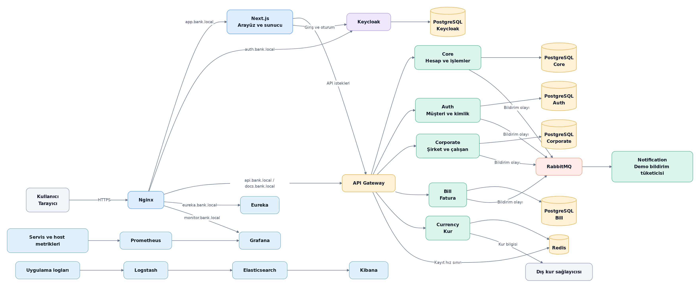

# Bank-Demo

Bireysel ve kurumsal bankacılık senaryolarını Java, Spring ve Next.js ile uygulayan
bir öğrenme projesi. Hesap ve para hareketlerinin yanında kimlik yönetimi,
servisler arası iletişim, gözlemleme ve Jenkins ile image yayını içerir.

## Uygulamada neler var?

- Bireysel müşteriler için kayıt, yönetici onayı, hesap açma, para yatırma ve transfer.
- Kurumsal müşteriler için çalışan, maaş ve otomatik ödeme işlemleri.
- Fatura ödeme talimatları ve döviz kuru ekranı.
- Yönetici için müşteri, erişim kısıtlaması, hesap ve işlem yönetimi.
- Merkezi loglar, servis/host metrikleri ve ilk kurulumda yüklenen Grafana panelleri.

Bu uygulama bir demo ortamıdır. Gerçek ödeme altyapısına bağlı değildir.

## Mimari

Tarayıcı Nginx üzerinden Next.js uygulamasına ulaşır. Next.js'in sunucu tarafı,
tarayıcı ile API arasında çalışır: Keycloak girişini ve şifreli oturum çerezlerini
yönetir, API isteklerini erişim token'ıyla Gateway'e iletir. Bu katmana BFF
(Backend for Frontend) denir.

Gateway istekleri ilgili servise yönlendirir. Korunan API'lerde ilgili servisler de
JWT ve erişim kontrollerini yapar. Servislerin kendi veritabanları vardır; bildirim
olayları RabbitMQ üzerinden Notification servisine ulaşır.

| Compose servisi | Kaynak | Sorumluluk |
| --- | --- | --- |
| frontend | [Bank-Demo-Frontend](Bank-Demo-Frontend) | Arayüz, giriş, oturum ve API aracılığı |
| api-gateway | [api-gateway](api-gateway) | API yönlendirme, yetki kontrolü ve kayıt hız sınırı |
| backend | [Bank-Demo-Backend](Bank-Demo-Backend) | Hesap, bakiye, transfer ve işlem onayları |
| auth-service | [bank-auth-micro](bank-auth-micro) | Müşteri kaydı, profil, erişim ve Keycloak yönetim entegrasyonu |
| corporate-service | [bank-corporate-micro](bank-corporate-micro) | Şirket, çalışan ve maaş işlemleri |
| bill-service | [bill-service](bill-service) | Fatura talimatları ve tahsilat |
| currency-service | [currency-service](currency-service) | Dış sağlayıcıdan kur alma ve önbellekleme |
| notification-service | [notification-service](notification-service) | RabbitMQ bildirimlerini demo olarak işleme |
| discovery-server | [discovery-server](discovery-server) | Eureka servis kaydı ve keşfi |

Ayrıntılı görünümler: [kimlik ve güvenlik](docs/mimari/kimlik-ve-guvenlik.md),
[servis iletişimi ve veri sahipliği](docs/mimari/servis-iletisimi.md).
Diyagramların Mermaid kaynakları ile PNG çıktıları birlikte tutulur.

## Teknolojiler

| Alan | Kullanım |
| --- | --- |
| Java 21, Spring Boot 4.x | Sekiz Java uygulaması |
| Spring Cloud Gateway, OpenFeign, Eureka | Yönlendirme, servis çağrıları ve keşif |
| Next.js 16, TypeScript, Zustand, Tailwind CSS | Arayüz ve sunucu tarafındaki oturum katmanı |
| Keycloak 24, Spring Security | OpenID Connect girişi, JWT ve servis yetkileri |
| PostgreSQL 15 | Core, Auth, Corporate, Bill ve Keycloak verileri |
| RabbitMQ, Redis | Bildirim mesajları, kur önbelleği ve kayıt hız sınırı |
| Elasticsearch, Logstash, Kibana | Merkezi uygulama logları |
| Prometheus, Grafana, cAdvisor, Node Exporter | Servis, container ve host gözlemleme |
| Docker Compose, Jenkins, BuildKit | Yerel çalıştırma, CI ve image yayını |

Kesin bağımlılık sürümleri ilgili `pom.xml`, `package-lock.json`, Dockerfile ve
[Compose](docker-compose.yml) dosyalarındadır.

## Yerelde çalıştırma

[Yerel kurulum ve işletim rehberi](docs/yerel-kurulum.md), temiz bir checkout'tan
başlamak için gereken adımları içerir: sertifika ve hosts hazırlığı, kök `.env`,
build, ilk yönetici hesabı ve erişim adresleri.

Yeni kurulumda Keycloak realm/client/rol ayarları ile ilk uygulama yöneticisi
hazırlanır. Grafana veri kaynağı ve iki dashboard dosyalardan yüklenir. Parolaları
üreten [hazırlık aracı](scripts/prepare-local-env.py) mevcut `.env` üzerine yazmaz.

Desteklenen akış Docker Compose ve `https://app.bank.local` adresidir. Sertifika/CA
hazırlığı gerekir; sertifikasız HTTP ve bağımsız frontend çalıştırma bu rehberin
kapsadığı yollar değildir.

## Jenkins ve image yayını

Günlük akış: yerelde değiştir ve dene → PR kontrolü → main'e merge → main CI →
Docker Hub image yayını.

| İş | Görevi |
| --- | --- |
| Bank-Demo-PR-CI/bank-microservice-pr-ci | PR için frontend ve Java kontrolleri |
| bankdemo-ci-build-pilot | SCM değişikliğinde main CI |
| Bank-Demo-Release/image-build-pilot | Başarılı main CI'ın doğruladığı commit'ten image yayını |

[Kaynak CI](Jenkinsfile) frontend lint, TypeScript ve production build ile Java
modüllerinin Maven kontrollerini çalıştırır.
[Publisher](Jenkinsfile.release), başarılı main CI'ın commit bilgisini alır ve
[yayın kataloğundaki](ci/release-services.txt) değişen image girdilerini seçer.
Değişmeyen servislerin önceki başarılı image referansı ve digest'i manifestte korunur.
Uygulama girdisi değişmediyse image build/push aşaması atlanabilir; kaynak CI yine çalışır.

Jenkins yerel Compose container'larını güncellemez. Docker Hub'da image yayımlanması
ile uygulamanın o image ile çalıştırılması ayrı işlemlerdir.

## Bilinen sınırlar

- Bildirim servisi gerçek e-posta/SMS göndermez; mesaj işleme davranışını gösterir.
- Kur bilgisi sağlayıcının güncelleme zamanına ve önbelleğe bağlıdır.
- TCKN kontrolü biçim ve kontrol basamaklarını doğrular; resmi kimlik doğrulaması değildir.
- Veritabanı transaction'ları uzak HTTP çağrıları ve RabbitMQ yayınıyla birlikte
  atomik bir işlem oluşturmaz.
- Şema hazırlığında Hibernate `ddl-auto=update` kullanılır. Sürümlenmiş migration
  ve gerçek bankacılık ortamı için operasyonel güvenceler bu projenin mevcut sınırlarıdır.
- İlk uygulama yöneticisinin örnek bilgileri yerel demo içindir.
