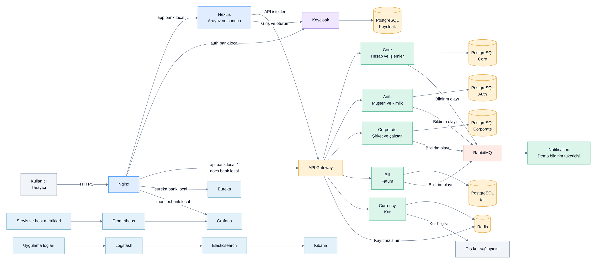

# Genel sistem mimarisi

Bu görünüm yerel Docker Compose ortamını özetler; bütün endpoint'leri ve servisler
arası çağrıları göstermez. Oklar ilgili iletişimin yönünü belirtir.

[PNG görüntüsü](genel-sistem.png)

**Okuma notları:** RabbitMQ üzerinden tüketilen bildirimler mevcut uygulamada gerçek
e-posta/SMS teslimi değil, demo davranışıdır. Gözlemleme zinciri okunabilirlik için
özetlenmiştir; her servis bağlantısı tek tek çizilmemiştir. Eureka bütün Gateway
route'larının kullandığı bir yönlendirme mekanizması değildir.

Kaynaklar: [Compose](../../docker-compose.yml), [Nginx](../../nginx.conf),
[Gateway route'ları](../../api-gateway/src/main/java/com/mustafa/config/GatewayRoutingConfig.java),
[Prometheus](../../prometheus/prometheus.yml).
