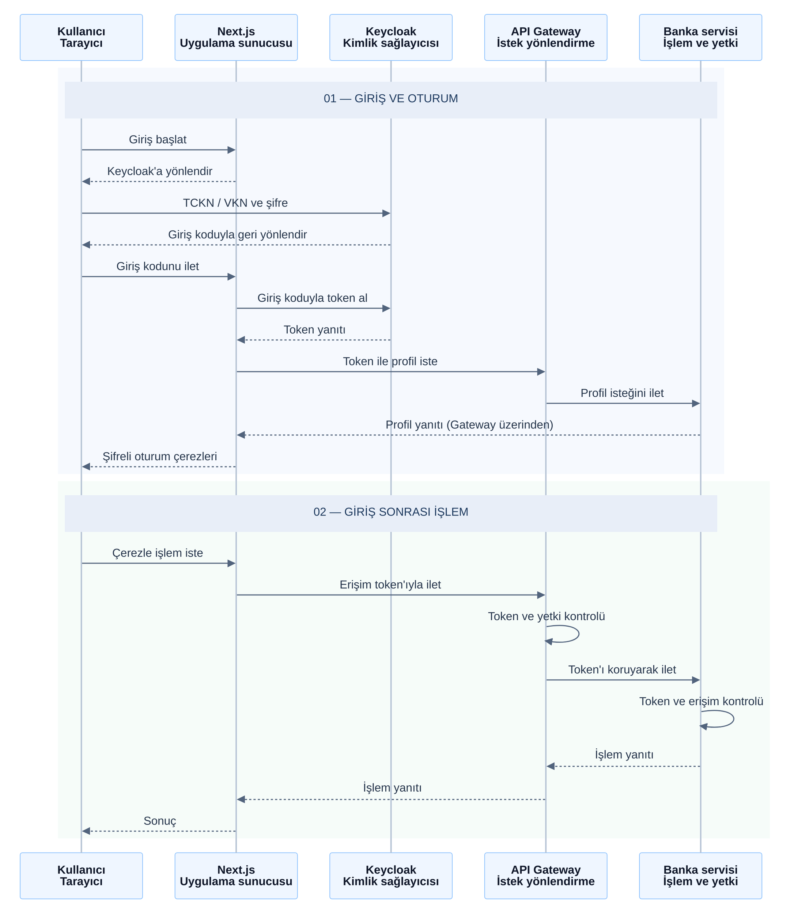

# Kimlik ve güvenlik akışı

Bu şema giriş ve oturum açılmış kullanıcının korunan API isteğini özetler; kayıt,
çıkış ve servisler arası tüm yetki akışlarının ayrıntılı dökümü değildir.

[PNG görüntüsü](kimlik-ve-guvenlik.png)

Bu sıralama diyagramında oklar işlemlerin gerçekleşme sırasını gösterir.
Giriş kodu Next.js tarafından
Keycloak'ın token endpoint'ine gönderilir; profil Gateway üzerinden Auth servisinden
alınır. Nginx'in HTTPS yönlendirmeleri genel sistem diyagramındadır.

Token'lar tarayıcı JavaScript'inin okuyacağı düz metin token cookie'leri olarak
kullanılmaz; Next.js sunucusu, oturum verisini şifreli cookie'de saklar. Çerezler
HttpOnly ve Secure niteliklerini taşır. Gateway, istemcinin gönderdiği kimlik
başlıklarını temizler ve Authorization başlığındaki token'ı korur. Next.js'in bu
sunucu katmanı BFF (Backend for Frontend) olarak da adlandırılır: tarayıcı ile API arasındaki
istekleri yönetir. Girişte state, nonce ve PKCE doğrulamaları kullanılır. CSRF koruması ve
oturum süresi gibi ayrıntılar okunabilirlik için şemada kısaltılmıştır. Açık
endpoint'ler bu korunan istek akışından farklıdır.

Kaynaklar: [BFF login](../../Bank-Demo-Frontend/app/api/auth/login/route.ts),
[callback](../../Bank-Demo-Frontend/app/api/auth/callback/route.ts),
[oturum](../../Bank-Demo-Frontend/lib/server/session.ts),
[Gateway filtresi](../../api-gateway/src/main/java/com/mustafa/filter/KeycloakHeaderFilter.java).
