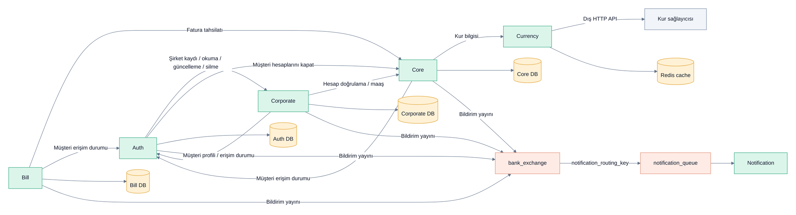

# Servis iletişimi ve veri sahipliği

Bu görünüm kaynak kodunda kullanım yeri bulunan başlıca çağrıları ve veri
sahipliğini gösterir; bütün endpoint'lerin veya her çağrının canlı kabulü değildir.

[PNG görüntüsü](servis-iletisimi.png)

HTTP çağrıları ile RabbitMQ olayları farklı iletişim biçimleridir; bu görünüm
veritabanı işlemi ile mesaj yayınının tek bir dağıtık transaction olduğunu iddia
etmez. Notification gerçek e-posta/SMS göndermek yerine demo işlemi yapar.
Eureka servis keşfine katılır; her Gateway route'u için kullanıldığı anlamına gelmez.

Kaynaklar: [Corporate çalışan işlemleri](../../bank-corporate-micro/src/main/java/com/mustafa/service/impl/CompanyEmployeeServiceImpl.java),
[Auth müşteri yönetimi](../../bank-auth-micro/src/main/java/com/mustafa/service/impl/AdminUserServiceImpl.java),
[Bill tahsilatı](../../bill-service/src/main/java/com/mustafa/service/impl/BillPaymentServiceImpl.java),
[RabbitMQ consumer yapılandırması](../../notification-service/src/main/java/com/mustafa/config/RabbitMQConfig.java).
